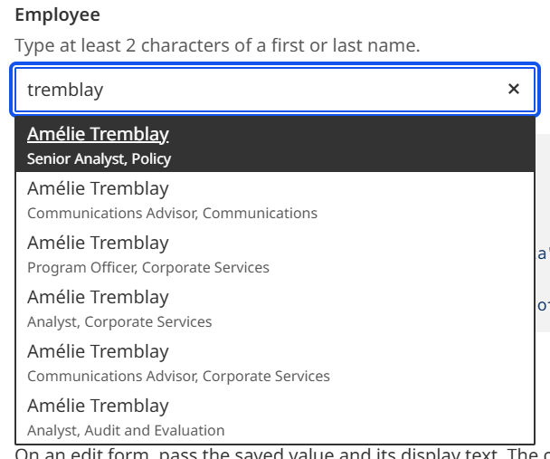
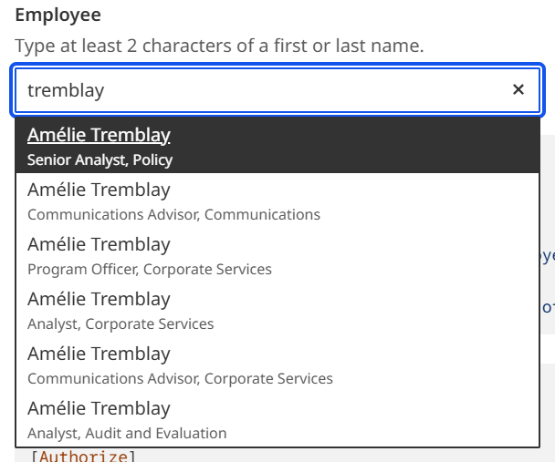
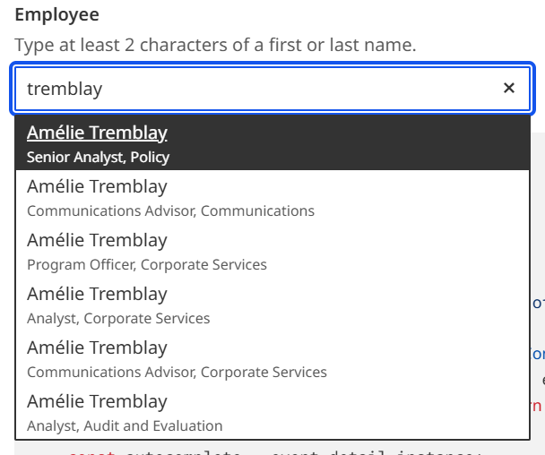
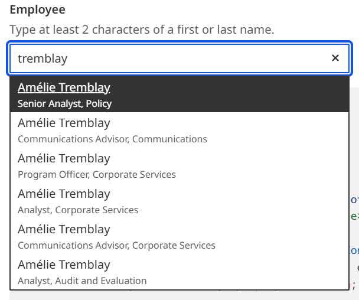
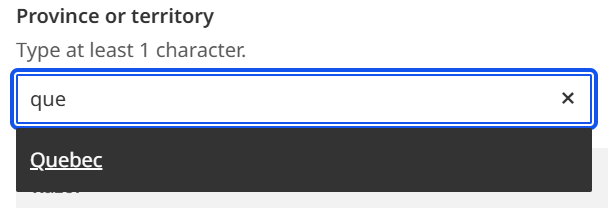

# fdcp-autocomplete: data sources

`fdcp-autocomplete` does not care where its suggestions come from. It needs one thing: for a search term and a page, something that returns

```json
{ "total": 144, "items": [{ "value": "E001233", "text": "Aiyana Côté", "description": "Program Officer, Digital Services" }] }
```

This page shows five ways to supply that, each as a working sample, with the evidence that it works.

| # | Data source | Where the work happens | Sample on the docs page | Sample element |
|---|---|---|---|---|
| 1 | [Web API](#1-web-api) (REST, `GET`) | Server. No script needed | Basic, Large dataset | `#employee` |
| 2 | [Database](#2-database) (LINQ / Entity Framework) | Server. No script needed | Data source: database | `#databaseEmployee` |
| 3 | [GraphQL](#3-graphql) (`POST`) | Custom `dataSource` in the page | Data source: GraphQL | `#graphqlEmployee` |
| 4 | [Existing API with a different shape](#4-existing-api-with-a-different-shape) | Custom `dataSource` that adapts | Data source: existing API | `#legacyEmployee` |
| 5 | [Data already on the page](#5-data-already-on-the-page) | Custom `dataSource`, no request | Data source: data on the page | `#localProvince` |

Live: run `GCFoundation.Web` and open `/en/components/autocomplete` or `/fr/composants/saisie-semi-automatique`.

**What is mocked.** All server samples read the same 5,000 seeded, fictional people (`AutocompleteSampleDirectory`). The database sample runs its LINQ query over an in-memory set, not a real database. The GraphQL endpoint is a mock that resolves one field from the request variables, not a GraphQL engine. The client code in every sample is real and is exactly what a consuming app would write.

## The two ways to connect a source

**The source already speaks the contract** (samples 1 and 2): set `src`. The component sends `GET {src}?q=…&skip=…&take=…&lang=…`.

**Anything else** (samples 3, 4, 5): replace the component's `dataSource` function. It receives `{ term, skip, take, lang, signal }` and returns `{ total, items }`, or a promise of it. Paging, virtualization, caching and stale-response handling keep working, because they sit above this function.

Attach it from the `fdcp-autocomplete:ready` event. The event fires when a component finishes setting up, so the code works wherever the script sits on the page:

```js
document.addEventListener('fdcp-autocomplete:ready', event => {
    if (event.target.id !== 'employee') return;

    event.detail.instance.dataSource = async ({ term, skip, take, lang, signal }) => {
        // ...call anything, then:
        return { total, items };
    };
});
```

Inline scripts need a CSP nonce: `<script nonce="@CspNonceHelper.AddNonceToDirective(Context, DirectiveType.Script)">`. A script file served from your own origin needs nothing.

---

## 1. Web API

Nothing to write in the page.

```cshtml
<fdcp-autocomplete name="employee"
                   src="@Url.Action("Search", "Employees")"
                   label="Employee"
                   hint="Type at least 2 characters of a first or last name."></fdcp-autocomplete>
```

```csharp
[Authorize]
[HttpGet("employees/search")]
public IActionResult Search(string? q, int skip = 0, int take = 50, string? lang = null)
{
    return Json(_directory.Search(q, skip, take, lang));   // FDCPAutocompleteResult
}
```

Demo endpoint: `ComponentsController.AutocompleteData` → `GET /en/components/autocomplete/data`.



## 2. Database

Also nothing to write in the page: the action queries the database and returns the contract.

```csharp
[Authorize]
[HttpGet("employees/search")]
public async Task<IActionResult> Search(string? q, int skip = 0, int take = 50, string? lang = null)
{
    // Limits are enforced here, whatever the browser sends.
    string term = Normalize(q);                       // lower case, accents removed
    if (term.Length < 2 || term.Length > 100) return Json(new FDCPAutocompleteResult(0, []));
    take = Math.Clamp(take, 1, 100);
    skip = Math.Clamp(skip, 0, 5000);

    // SearchName is an indexed column holding the normalized name, so matching does not depend on collation.
    IQueryable<Employee> matches = _db.Employees.Where(e => e.SearchName.Contains(term));

    int total = await matches.CountAsync();           // SELECT COUNT(*)
    var page = await matches                          // SELECT ... ORDER BY ... OFFSET ... FETCH
        .OrderBy(e => e.SearchName).ThenBy(e => e.Id)
        .Skip(skip).Take(take)
        .Select(e => new FDCPAutocompleteItem(e.Id, e.Name, lang == "fr" ? e.TitleFr : e.TitleEn))
        .ToListAsync();

    return Json(new FDCPAutocompleteResult(total, page));
}
```

Three things make this hold up on a real database:

- **A normalized search column.** Accent- and case-insensitive matching differs between database engines and collations. Storing a lower-cased, accent-stripped copy of the name (`SearchName`) and normalizing the term the same way gives identical results everywhere. Stripping accents does not change letters that have no accented base form, so the sample's `NormalizeTerm` also spells out `œ`→`oe`, `æ`→`ae`, `ø`→`o`, `ß`→`ss` and `ł`→`l`: "coeur" finds "Cœur". The sample stores both name orders in it ("marie tremblay tremblay, marie") so "Tremblay, Marie" also matches.
- **A stable sort.** `OrderBy(SearchName).ThenBy(Id)` gives every row a fixed position, so pages never overlap or skip a row. Without the tie-breaker, people with the same name can swap pages between requests.
- **A parameterized query.** LINQ sends the term as a parameter. Never build SQL by concatenating it.

`Contains` becomes `LIKE '%term%'`, which scans the table. That is fine for thousands of rows; for millions, use a full-text or trigram index.

Demo endpoint: `ComponentsController.AutocompleteDatabase` → `GET /en/components/autocomplete/sources/database`. It runs this same LINQ query through `IAutocompleteSampleDirectory.Query()`, an `IQueryable` over the in-memory records.



## 3. GraphQL

```cshtml
<fdcp-autocomplete name="graphqlEmployee" src="/graphql" label="Employee"></fdcp-autocomplete>
```

```js
document.addEventListener('fdcp-autocomplete:ready', event => {
    if (event.target.id !== 'graphqlEmployee') return;

    const autocomplete = event.detail.instance;
    const query = `
        query Employees($term: String!, $skip: Int!, $take: Int!, $lang: String!) {
            employees(term: $term, skip: $skip, take: $take, lang: $lang) {
                total
                items { value text description }
            }
        }`;

    autocomplete.dataSource = async ({ term, skip, take, lang, signal }) => {
        const response = await fetch(autocomplete.src, {
            method: 'POST',
            credentials: 'same-origin',
            signal,
            headers: {
                'Content-Type': 'application/json',
                'Accept': 'application/json',
                'X-Requested-With': 'XMLHttpRequest'
            },
            body: JSON.stringify({ query, variables: { term, skip, take, lang } })
        });

        if (!response.ok) throw new Error('Request failed: ' + response.status);

        const result = await response.json();
        if (result.errors) throw new Error(result.errors[0].message);

        return result.data.employees;   // { total, items: [{ value, text, description }] }
    };
});
```

Points worth copying:

- **Variables, not string building.** The term goes in `variables`, never into the query text.
- **GraphQL errors arrive with HTTP 200.** Check `result.errors` and throw; the component then shows its load error and recovers on the next keystroke.
- **Pass `signal` through**, so a newer keystroke cancels the request.
- A `POST` also keeps the search term out of the URL and so out of access logs.

Demo endpoint: `ComponentsController.AutocompleteGraphQL` → `POST /en/components/autocomplete/sources/graphql`. Antiforgery validation is off on purpose there: the request only reads data. An endpoint that changes state must validate the token.



## 4. Existing API with a different shape

An API you cannot change pages by number and answers `{ count, page, pageSize, results: [{ id, displayName, titleEn, titleFr }] }`. The data source translates in both directions.

```cshtml
<fdcp-autocomplete name="legacyEmployee" src="/api/v1/people" label="Employee" page-size="25"></fdcp-autocomplete>
```

```js
document.addEventListener('fdcp-autocomplete:ready', event => {
    if (event.target.id !== 'legacyEmployee') return;

    const autocomplete = event.detail.instance;

    autocomplete.dataSource = async ({ term, skip, lang, signal }) => {
        const url = new URL(autocomplete.src, document.baseURI);
        url.searchParams.set('search', term);
        url.searchParams.set('page', String(skip / autocomplete.pageSize + 1));
        url.searchParams.set('pageSize', String(autocomplete.pageSize));

        const response = await fetch(url, {
            credentials: 'same-origin',
            signal,
            headers: { 'Accept': 'application/json', 'X-Requested-With': 'XMLHttpRequest' }
        });

        if (!response.ok) throw new Error('Request failed: ' + response.status);

        const body = await response.json();

        return {
            total: body.count,
            items: body.results.map(person => ({
                value: person.id,
                text: person.displayName,
                description: lang === 'fr' ? person.titleFr : person.titleEn
            }))
        };
    };
});
```

Set `page-size` to a size the API accepts. The component always asks for whole pages, so `skip / pageSize + 1` is always a whole page number.

Demo endpoint: `ComponentsController.AutocompleteLegacy` → `GET /en/components/autocomplete/sources/legacy`.



## 5. Data already on the page

No server call at all. The function may return its result directly; it does not have to be `async`.

```cshtml
<fdcp-autocomplete name="localProvince" src="#" label="Province or territory"
                   min-length="1" debounce="0" cache="false"></fdcp-autocomplete>
```

```js
document.addEventListener('fdcp-autocomplete:ready', event => {
    if (event.target.id !== 'localProvince') return;

    const autocomplete = event.detail.instance;
    const provinces = [
        { value: 'AB', en: 'Alberta', fr: 'Alberta' },
        { value: 'BC', en: 'British Columbia', fr: 'Colombie-Britannique' },
        // ...
        { value: 'YT', en: 'Yukon', fr: 'Yukon' }
    ];
    const fold = text => text.normalize('NFD').replace(/[\u0300-\u036f]/g, '').toLowerCase()
        .replace(/[œæøßł]/g, letter => ({ 'œ': 'oe', 'æ': 'ae', 'ø': 'o', 'ß': 'ss', 'ł': 'l' })[letter]);

    autocomplete.dataSource = ({ term, skip, take, lang }) => {
        const matches = provinces
            .map(province => ({ value: province.value, text: province[lang] || province.en }))
            .filter(province => fold(province.text).includes(fold(term)));

        return { total: matches.length, items: matches.slice(skip, skip + take) };
    };
});
```

`src` is still required by the tag helper; `#` is enough when the default lookup is replaced. With no network there is nothing to debounce or cache, so both are turned off.

For a short fixed list like this one, `fdcp-searchable-select` is usually the simpler choice. Use this approach when the data comes from somewhere only script can reach: IndexedDB, a WebSocket, a list another widget already loaded.



---

## Evidence

Every claim above is checked by an automated test. Results below are from the run on 2026-11-17 (Windows 11, .NET 10.0, Node 22.14, Chrome and Edge).

### The samples work in a real browser

`e2e/tests/fdcp-autocomplete.sources.spec.ts` drives the live docs page against the running app, with no mocks. **11 tests, run in Chrome and Edge: 22 of 22 passed.**

| Test | What it proves |
|---|---|
| Web API / Database / GraphQL / Existing API: *search, page, select and submit a value* (4 tests) | Typing calls that sample's own endpoint with the right verb and the term; the response is 200; results render with descriptions; scrolling to the end requests only the last page; clicking a row puts `E######` in the hidden field named after the component; repeating the search makes no request (cache); no CSP violation is logged |
| *all four server sources show the same results for the same search* | For "côté", all four show the same total and the same first six names and descriptions |
| *all four server sources answer in French on the French page* | Same record, description in French, French status text |
| GraphQL: *posts a query document with variables and reads the data envelope* | Body is `{ query, variables: { term, skip, take, lang } }`, content type JSON; response is `{ data: { employees } }`; the first row shown is the first item returned |
| GraphQL: *a GraphQL error is shown as a load error, then recovers* | A 200 response with `errors` shows "Unable to load results", and the next search works |
| Existing API: *translates skip to a page number and maps the response fields* | Request has `search`, `page`, `pageSize` and no `q` or `skip`; response keys are the API's own; row 61 triggers pages 1, 2, 3 in order |
| Data on the page: *filters locally with no request, in both languages* | Zero network requests; "n" gives the 10 matching provinces; "ile" on the French page finds "Île-du-Prince-Édouard" and submits `PE` |
| *the code shown for each sample is the code the page runs* | The script displayed in each sample is the script executing on the page (compared ignoring whitespace) |

The screenshots on this page are taken by these tests while the list is open. Regenerate them with:

```
cd e2e
FDCP_EVIDENCE_DIR=../GCFoundation.Components/Documentation/fdcp-autocomplete/evidence npx playwright test fdcp-autocomplete.sources
```

### The server endpoints are correct and agree with each other

`GCFoundation.Tests.Components/Tests/Controllers/AutocompleteDataSourceEndpointTests.cs`, xUnit with Moq and Bogus (Faker). **21 test cases, all passed.**

| Test | What it proves |
|---|---|
| `AllSources_GeneratedSearches_ReturnIdenticalResults` | For 300 Faker-generated searches (random term, page, page size, language), Web API, database, GraphQL and existing API return the same total and the same items |
| `AllSources_PagedToTheEnd_ReturnEveryMatchOnce` | Paging each source to the end returns every match exactly once: no gaps, no repeats |
| `Database_RunsItsQueryThroughTheQueryableSet` | With a mocked set (Moq, strict), the action queries only through `IQueryable`, filters, sorts and returns French descriptions |
| `Database_GeneratedRows_AreFilteredSortedAndPaged` | Over 5,000 Faker rows, 100 random queries match an independently computed expected result |
| `Database_TermTooShort_NeverTouchesTheDatabase` | A term under 2 characters returns nothing and the set is never queried |
| `Database_ClampsPageSizeAndDepth`, `Legacy_ClampsPageAndPageSize` | Oversized `take`, negative `skip` and absurd page numbers are clamped on the server |
| `GraphQL_ReturnsDataEnvelope`, `GraphQL_ReadsVariablesAndPassesThemToTheResolver` | Response shape and variable handling |
| `GraphQL_MissingOrWrongTypedVariables_FallBackToDefaults` | Wrong-typed variables cannot break the resolver |
| `GraphQL_UnknownDocument_ReturnsErrorsAndRunsNothing` | Introspection, mutations and empty documents get `errors`, and nothing is executed |
| `Legacy_ReturnsItsOwnShapeWithBothLanguages` | The existing API really has a different shape (`count`/`results`, no `total`/`items`) |
| `AllSources_GeneratedGarbage_NeverThrow` | 200 rounds of random bytes, injection strings and extreme paging values: no exception, never more than the page limit |

### Checked by hand while building

Each endpoint was also called directly, returning the same record for the same query:

```
GET  /en/components/autocomplete/sources/database?q=cote&take=1
  {"total":144,"items":[{"value":"E001233","text":"Aiyana Côté","description":"Program Officer, Digital Services"}]}

GET  /en/components/autocomplete/sources/legacy?search=cote&pageSize=1
  {"count":144,"page":1,"pageSize":1,"results":[{"id":"E001233","displayName":"Aiyana Côté","titleEn":"Program Officer, Digital Services","titleFr":"Agent de programme, Services numériques"}]}

POST /en/components/autocomplete/sources/graphql   {"query":"{ employees { total } }","variables":{"term":"cote","take":1,"lang":"fr"}}
  {"data":{"employees":{"total":144,"items":[{"value":"E001233","text":"Aiyana Côté","description":"Agent de programme, Services numériques"}]}}}

POST /fr/composants/autocomplete/sources/graphql   {"query":"{ nope }"}
  {"errors":[{"message":"Unknown query. This mock resolves only the 'employees' field."}]}
```

### What this evidence does not cover

- **No real database.** The LINQ query is proven correct over in-memory data. Its translation to SQL, index use and collation behaviour on your database engine are not tested here.
- **No real GraphQL server.** The client code is exercised end to end, but against a mock that ignores the query text beyond checking the field name.
- **Authorization** is shown in the samples (`[Authorize]`) but the demo endpoints are open, because the data is fictional.
